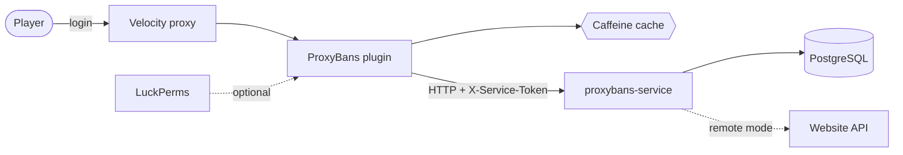

# ProxyBans — Velocity plugin

[](https://github.com/vanfek/proxybans-plugin/actions/workflows/ci.yml)
[](https://openjdk.org/projects/jdk/25/)

*[Русская версия](README.ru.md)*

Proxy-side ban system for [Velocity](https://papermc.io/software/velocity). Ban state lives in a
separate service ([proxybans-service](https://github.com/vanfek/proxybans-service)), so the same
plugin works whether punishments are stored in its own database or already owned by a website.

The interesting part is not the commands — it is what happens when the network misbehaves. A ban
check sits on the critical path of every player connection, so the plugin answers from a cache when
it can, falls back to a recent stale answer while the service is unreachable, and, when nothing
usable is cached, applies a configurable fail-open policy: the player is let in and the incident is
logged. Locking an entire network out because one internal service restarted is usually the worse
failure; `login.fail-open: false` inverts that trade-off.

---

## How it fits together



Three Gradle modules, dependencies pointing one way only:

| Module             | Contents                                                            |
|--------------------|---------------------------------------------------------------------|
| `modules/api`      | public SPI — `BanService`, `ActiveBanView`, `PunishmentHistoryEntry` |
| `modules/core`     | HTTP client, cache, config, permissions, MiniMessage rendering       |
| `modules/velocity` | Velocity entry point, commands, login listener                       |

`core` talks to the service through the `BansClient` interface, so everything above the socket —
caching, the login decision, command handling — is tested without one.

## Commands

Every command is available as `/pb <subcommand>` and, unless disabled, as a top-level alias. Names
already claimed by another plugin are skipped with a warning instead of being overwritten.

| Command       | Aliases                                       | Permission                  |
|---------------|-----------------------------------------------|-----------------------------|
| `/ban`        | `permban`, `blacklist`, `banplayer`, `punish` | `proxybans.command.ban`     |
| `/tempban`    | `tban`, `timedban`                            | `proxybans.command.tempban` |
| `/unban`      | `pardon`, `unblacklist`                       | `proxybans.command.unban`   |
| `/baninfo`    | `checkban`, `isbanned`, `banstatus`           | `proxybans.command.info`    |
| `/banhistory` | `banlog`, `punishments`                       | `proxybans.command.history` |
| `/banlist`    | `bans`, `activebans`                          | `proxybans.command.list`    |
| `/pb kick`    | —                                             | `proxybans.command.kick`    |

`proxybans.admin` grants all of the above.

**Durations**: `30s`, `5m`, `2h30m`, `7d`, `1w`, `3M`, `1y`, or `perm` / `forever` / `0`.
Unit letters are case sensitive — `m` is minutes, `M` is months. Overflow, zero-length and
absurdly long durations are rejected rather than stored as a ban that expires in the past.

`/ban <player> [duration] <reason…>` takes the duration only when the first word actually looks like
one, so `/ban Steve cheating with hacks` bans Steve for cheating instead of complaining about an
invalid duration.

## Configuration

`plugins/proxybans/config.yml`:

```yaml
service:
  base-url: "http://proxybans:8080"
  token: ""              # must match PROXYBANS_SERVICE_TOKEN on the service
  connect-timeout: PT2S
  request-timeout: PT3S

cache:
  active-ttl: PT30S      # a fresh answer is served without asking again
  stale-ttl: PT30M       # how long a stale answer may cover an outage
  max-size: 100000

login:
  fail-open: true
  remember-player: true

commands:
  register-top-level-aliases: true
```

`plugins/proxybans/messages.yml` holds every string as a
[MiniMessage](https://docs.advntr.dev/minimessage/format.html) template. Placeholder values are
inserted verbatim and never parsed as markup, so a player cannot smuggle formatting, hover text or
click actions into staff messages through their name or a ban reason. Keys added in later versions
fall back to the bundled defaults instead of rendering as an error.

## Permissions

With LuckPerms installed, checks go through its player adapter. Without it, Velocity's native check
applies, which grants players nothing and the console everything — a misconfigured server locks
staff out rather than handing `/ban` to everyone.

## Building

```bash
./gradlew build          # compiles, runs tests, produces the shaded jar
```

Artifact: `modules/velocity/build/libs/ProxyBans-1.0.0.jar` → drop into `plugins/`.

Requires JDK 25. The Gradle wrapper is committed; nothing else needs installing.

## Tests

```bash
./gradlew test
```

Covered on purpose, because these are the places where a regression is expensive:

- duration parsing — months vs minutes, overflow, malformed input, the `/ban` argument split
- cache behaviour — fresh, stale, expired, negative caching (verified against a controllable clock)
- the login decision — banned, expired, fail-open, fail-closed, stale-cache enforcement
- the HTTP client — against a real socket: query escaping, non-JSON error pages, connection failures
