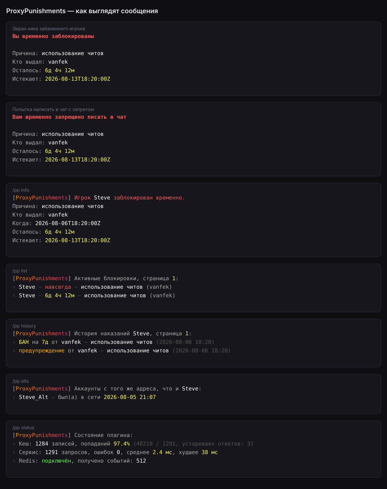
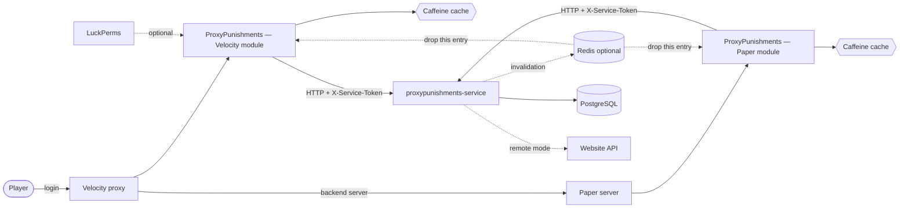

# ProxyPunishments — Velocity and Paper plugin

[](https://github.com/vanfek/proxypunishments-plugin/actions/workflows/ci.yml)
[](https://openjdk.org/projects/jdk/25/)

*[Русская версия](README.ru.md)*

Ban system for [Velocity](https://papermc.io/software/velocity) and
[Paper](https://papermc.io/software/paper). Ban state lives in a separate service
([proxypunishments-service](https://github.com/vanfek/proxypunishments-service)), so the same plugin works whether
punishments are stored in its own database or already owned by a website.

The interesting part is not the commands — it is what happens when the network misbehaves. A ban
check sits on the critical path of every player connection, so the plugin answers from a cache when
it can, falls back to a recent stale answer while the service is unreachable, and, when nothing
usable is cached, applies a configurable fail-open policy: the player is let in and the incident is
logged. Locking an entire network out because one internal service restarted is usually the worse
failure; `login.fail-open: false` inverts that trade-off.



A render of the message templates, not an in-game screenshot:
[`docs/preview/render_messages.py`](docs/preview/render_messages.py) draws it straight from
`messages.yml`, so the picture cannot drift away from what an operator actually configures.

---

## How it fits together



Four Gradle modules, dependencies pointing one way only:

| Module             | Contents                                                             |
|--------------------|----------------------------------------------------------------------|
| `modules/api`      | public SPI — `PunishmentService`, `ActivePunishmentView`, `Actor`    |
| `modules/core`     | HTTP client, cache, config, permissions, MiniMessage rendering        |
| `modules/velocity` | Velocity entry point, commands, login listener                        |
| `modules/paper`    | Paper entry point, commands, pre-login listener, chat mute listener   |

`api` and `core` carry no platform types at all, so a second platform is platform glue and nothing
else: `modules/paper` adds Brigadier command trees, two listeners and an `Actor`, and reuses
`PunishmentServiceImpl`, `PunishmentCache`, `ConfigLoader` and `MessageBundle` unchanged.

`core` talks to the service through the `PunishmentsClient` interface, so everything above the socket —
caching, the login decision, command handling — is tested without one.

## Which module to install

| | Velocity module | Paper module |
|---|---|---|
| Artifact | `ProxyPunishments-1.0.0.jar` | `ProxyPunishments-Paper-1.0.0.jar` |
| Blocks banned logins | yes, at the proxy | yes, on the backend server |
| Blocks muted chat | no — signed chat cannot be intercepted reliably | **yes** |
| Owns the commands | always | only on a standalone server |

Run a network behind a proxy: install both. The Velocity module issues and lifts punishments and
stops banned players at the edge; the Paper module exists for the one thing Velocity cannot do,
enforcing mutes, because signed chat from 1.19 on makes proxy-side chat interception unreliable.

Run a single Paper server with no proxy: install only the Paper module. It registers the full command
set and enforces both bans and mutes.

**Command ownership**: `commands.mode` decides whether the Paper module registers commands at all.
The default `auto` registers nothing when the server reports BungeeCord or Velocity forwarding as
enabled — the proxy owns the commands there — and registers everything on a standalone server;
`always` and `never` override the detection. The branch taken is logged on startup, so an admin never
has to guess where a command went.

Both modules read the same `config.yml` and `messages.yml`, and both talk to the same service, so a
mute issued on the proxy is enforced by the Paper module without any further wiring.

## Commands

Every command is available as `/pp <subcommand>` and, unless disabled, as a top-level alias. Names
already claimed by another plugin are skipped with a warning instead of being overwritten. Both
modules register the same tree with the same permission nodes; on Paper, whether they are registered
at all is decided by `commands.mode`.

| Command       | Aliases                                               | Permission                   |
|---------------|-------------------------------------------------------|------------------------------|
| `/ban`        | `permban`, `blacklist`, `banplayer`, `punish`         | `proxypunishments.command.ban`      |
| `/tempban`    | `tban`, `timedban`                                    | `proxypunishments.command.tempban`  |
| `/unban`      | `pardon`, `unblacklist`                               | `proxypunishments.command.unban`    |
| `/mute`       | `permmute`, `silence`, `muteplayer`                   | `proxypunishments.command.mute`     |
| `/tempmute`   | `tmute`, `timedmute`                                  | `proxypunishments.command.tempmute` |
| `/unmute`     | `unsilence`, `pardonmute`                             | `proxypunishments.command.unmute`   |
| `/warn`       | `caution`, `warnplayer`                               | `proxypunishments.command.warn`     |
| `/baninfo`    | `checkban`, `isbanned`, `banstatus`, `punishmentinfo` | `proxypunishments.command.info`     |
| `/banhistory` | `banlog`, `punishments`                               | `proxypunishments.command.history`  |
| `/banlist`    | `bans`, `activebans`, `punishmentlist`                | `proxypunishments.command.list`     |
| `/ipban`      | `banip`, `ipblacklist`                                | `proxypunishments.command.ipban`    |
| `/unipban`    | `unbanip`, `pardonip`                                 | `proxypunishments.command.unipban`  |
| `/alts`       | `accounts`, `altaccounts`                             | `proxypunishments.command.alts`     |
| `/pp kick`    | —                                                     | `proxypunishments.command.kick`     |
| `/pp status`  | `/pp stats`                                           | `proxypunishments.command.status`   |
| `/pp reload`  | —                                                     | `proxypunishments.command.reload`   |

`proxypunishments.admin` grants all of the above.

`/pp reload` re-reads `config.yml` and `messages.yml` and swaps both in at once — or neither, if one
of them fails to parse, in which case the failure is reported and the plugin keeps serving what it
already had. Everything bound while the plugin was starting is listed back with its running and its
configured value, so nobody has to guess whether a restart is still needed: the service URL, token
and timeouts, the cache sizing, the Redis connection and the command registration cannot be moved
without one. `login.*` and `chat.*` take effect the moment the command returns.

**Durations**: `30s`, `5m`, `2h30m`, `7d`, `1w`, `3M`, `1y`, or `perm` / `forever` / `0`.
Unit letters are case sensitive — `m` is minutes, `M` is months. Overflow, zero-length and
absurdly long durations are rejected rather than stored as a ban that expires in the past.

`/ban <player> [duration] <reason…>` takes the duration only when the first word actually looks like
one, so `/ban Steve cheating with hacks` bans Steve for cheating instead of complaining about an
invalid duration. `/mute` and `/tempmute` split their arguments the same way; `/warn <player>
<reason…>` is log-only, with no duration and nothing to lift.

Mutes are issued on the proxy and enforced by the Paper module — signed chat from 1.19 on makes
proxy-side chat interception unreliable. `/baninfo <player>` reports the active ban and the active
mute; `/baninfo <player> mute` and `/banlist [ban|mute] [page]` narrow either to one kind.

`/ipban <player|address> [duration] <reason…>` and `/unipban <player|address> [reason]` take either
a literal IPv4/IPv6 address or the name of a player who is online, in which case the address they are
connected from is used. Anything else is reported rather than guessed at. An IP ban is checked at
login after the player's own ban and denies the connection with its own kick message, so a banned
address keeps out accounts that were never punished themselves. `/alts <player>` lists the other
accounts last seen from that player's address, most recent first.

## Cross-proxy cache invalidation

A punishment issued on one proxy is invisible to another proxy's cache until `cache.active-ttl` runs
out — 30 seconds by default. Point both at the same Redis as the service and that window closes: the
service publishes one message per issue and lift, every plugin instance drops exactly that one entry
and asks the service again on the next lookup.

```yaml
redis:
  enabled: true
  host: "redis"
  channel: "proxypunishments.invalidations"   # must match the service
```

**Optional and off by default.** With `enabled: false` no Redis code runs at all and the plugin
behaves exactly as it did before. With Redis on but unreachable, the subscription fails, is logged
once, and retries every `reconnect-delay` in the background; punishments keep working from the cache
and the TTL, and nothing is thrown at a login or a command.

The subscriber owns a dedicated daemon thread named `proxypunishments-redis-subscriber`. Redis'
`SUBSCRIBE` blocks its connection for as long as it is subscribed, so it must never sit on a Netty
or main-server thread — it does not.

**Which client and why**: [Jedis](https://github.com/redis/jedis) through its low-level `Connection`
plus `JedisPubSub`, not Lettuce. Lettuce drags in the whole Netty stack, which a proxy already has —
in an incompatible version — and shading a second Netty into a plugin jar is how classloader
arguments start. Jedis is a plain socket and a blocking read, which is exactly the shape of "one
thread that sits on SUBSCRIBE". Using `Connection` rather than the `Jedis` facade keeps the command
surface, and therefore the shaded jar, far smaller; gson, slf4j and `org.json` are excluded because
both platforms already ship them. Jedis and commons-pool2 are relocated under
`net.vanfek.proxypunishments.libs`, so a second plugin bundling its own Jedis cannot collide with
this one. The cost is honest: about **485 KiB**, taking each shaded jar from ~1.78 MiB to ~2.26 MiB.

## Status and metrics

A proxy has nothing to scrape, so the numbers come out through `/pp status`:

- cache entries held, hit ratio, hits, misses and how many answers were served stale during an outage
- service calls, failures, average and slowest round trip
- whether Redis invalidation is off, connected or disconnected, and how many events have been applied

The same summary is logged when the plugin shuts down, so a restart leaves a record of how the cache
behaved without anyone having to have run a command.

## Configuration

`plugins/proxypunishments/config.yml`:

```yaml
service:
  base-url: "http://proxypunishments:8080"
  token: ""              # must match PROXYPUNISHMENTS_SERVICE_TOKEN on the service
  connect-timeout: PT2S
  request-timeout: PT3S

cache:
  active-ttl: PT30S      # a fresh answer is served without asking again
  stale-ttl: PT30M       # how long a stale answer may cover an outage
  max-size: 100000

redis:                   # optional, off by default
  enabled: false
  host: "redis"
  port: 6379
  username: ""
  password: ""
  database: 0
  channel: "proxypunishments.invalidations"   # must match the service
  connect-timeout: PT2S
  reconnect-delay: PT5S

login:
  fail-open: true
  remember-player: true

chat:                    # Paper module only
  enforce-mute: true
  fail-open: true        # service down and nothing cached: let the message through
  blocked-commands: ["msg", "tell", "w", "whisper", "r", "reply", "me", "say", "pm"]

commands:
  register-top-level-aliases: true
  mode: auto             # Paper module only: auto | always | never
```

`chat.blocked-commands` covers the commands that are chat by another name; a muted player is stopped
on `/msg` as well as in chat. A namespace prefix such as `essentials:msg` is stripped before
matching, so aliasing does not get around the mute.

`plugins/proxypunishments/messages.yml` holds every string as a
[MiniMessage](https://docs.advntr.dev/minimessage/format.html) template. Placeholder values are
inserted verbatim and never parsed as markup, so a player cannot smuggle formatting, hover text or
click actions into staff messages through their name or a ban reason. Keys added in later versions
fall back to the bundled defaults instead of rendering as an error.

## Permissions

With LuckPerms installed, checks go through its player adapter. Without it, the platform's native
check applies, which grants players nothing and the console everything — a misconfigured server locks
staff out rather than handing `/ban` to everyone.

## Personal data

With `login.remember-player` on, the plugin reports the address a player connects from alongside
their name, and the service stores it as that player's last known address. That is what makes IP
bans enforceable at login and `/alts` able to answer at all. An IP address is personal data in most
jurisdictions; how long it is kept, who may read it and when it is erased are the operator's
responsibility — nothing here expires it. Turn `login.remember-player` off and no address leaves the
proxy.

## Building

```bash
./gradlew build          # compiles, runs Checkstyle and the tests, produces the shaded jar
```

Artifacts: `modules/velocity/build/libs/ProxyPunishments-1.0.0.jar` and
`modules/paper/build/libs/ProxyPunishments-Paper-1.0.0.jar` → drop into `plugins/`.

Requires JDK 25. The Gradle wrapper is committed; nothing else needs installing.

The toolchain and the bytecode target are deliberately different: the build runs on a JDK 25
toolchain but compiles with `--release 21`, so the jars load on the Java 21 servers most people run.

Checkstyle is part of `build` and fails it on a style regression. The rules live in
[`config/checkstyle/checkstyle.xml`](config/checkstyle/checkstyle.xml) and describe the conventions
the sources already follow — a style check that demands a reformat is a style check nobody runs.

Notable changes are recorded in [`CHANGELOG.md`](CHANGELOG.md). Pushing a `v*` tag runs the release
workflow, which builds both modules and attaches the two jars to the GitHub release.

## Tests

```bash
./gradlew test
```

Covered on purpose, because these are the places where a regression is expensive:

- duration parsing — months vs minutes, overflow, malformed input, the `/ban` argument split
- address parsing — literals accepted, host names, malformed and injection-shaped input rejected
- cache behaviour — fresh, stale, expired, negative caching, and address entries that never answer a
  player lookup nor the other way round (verified against a controllable clock)
- the login decision — banned, expired, fail-open, fail-closed, stale-cache enforcement, and an IP
  ban denying a player who carries no ban of their own
- command arguments — the mute duration split, `/warn` without a reason, `/banlist` kind and page,
  `/ipban` against an address and against an online player, `/alts`, and `proxypunishments.admin`
  covering the new nodes
- the HTTP client — against a real socket: query escaping, non-JSON error pages, connection failures,
  the address endpoints and the address carried in the remember call
- cache invalidation — an event dropping the right entry and only that one, addresses kept apart
  from players, events for other targets ignored, malformed payloads dropped rather than applied,
  Redis off starting nothing, and an unreachable Redis never reaching a punishment lookup
- the metrics behind `/pp status` — hit ratio across repeat lookups, stale answers counted apart
  from hits
- `/pp reload` — a swap taking effect on the next message rendered, a malformed file leaving the
  previous configuration in place, and the reply naming the settings only a restart can change
- the Paper module — proxy auto-detection for all three `commands.mode` values, the chat mute
  decision (active, expired, service down under both fail-open settings), console identity mapping
