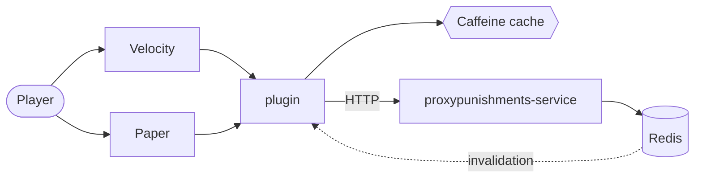

# ProxyPunishments — Velocity and Paper plugin

[](https://github.com/vanFEK/proxypunishments-plugin-example/actions/workflows/ci.yml)
[](https://openjdk.org/projects/jdk/25/)

*[Русская версия](README.ru.md)*

Bans, mutes, warnings and IP bans for Minecraft networks. State lives in a separate service
([proxypunishments-service](https://github.com/vanFEK/proxypunishments-service-example)), so the
same plugin works whether punishments are stored in its own database or already owned by a website.

A ban check sits on the critical path of every connection, so the plugin answers from cache, falls
back to a recent stale answer while the service is unreachable, and applies a configurable fail-open
policy when nothing usable is cached — one banned player slipping in beats locking out the network.

## Architecture



| Module             | Contents                                                       |
|--------------------|----------------------------------------------------------------|
| `modules/api`      | public SPI — `PunishmentService`, `ActivePunishmentView`, `Actor` |
| `modules/core`     | HTTP client, cache, config, permissions, MiniMessage rendering  |
| `modules/velocity` | proxy entry point, commands, login enforcement                  |
| `modules/paper`    | server entry point, commands, login and chat enforcement        |

Neither `api` nor `core` imports Velocity or Bukkit — that is what let the Paper module be glue and
no new decision logic.

**Which to install.** Network behind a proxy: Velocity module for commands and login, Paper module
on each server for mute enforcement in chat, which a proxy cannot do reliably since signed chat
landed in 1.19. Standalone server: Paper module alone. The Paper module detects proxy forwarding and
lets the proxy own the commands; `commands.mode` overrides that.

## Commands

Available as `/pp <subcommand>` and, unless disabled, as top-level aliases. Names already claimed by
another plugin are skipped with a warning rather than overwritten.

| Command       | Aliases                                       | Permission node   |
|---------------|-----------------------------------------------|-------------------|
| `/ban`        | `permban`, `blacklist`, `banplayer`, `punish` | `…command.ban`     |
| `/tempban`    | `tban`, `timedban`                            | `…command.tempban` |
| `/unban`      | `pardon`, `unblacklist`                       | `…command.unban`   |
| `/mute`       | `permmute`, `silence`, `muteplayer`           | `…command.mute`    |
| `/tempmute`   | `tmute`, `timedmute`                          | `…command.tempmute`|
| `/unmute`     | `unsilence`, `pardonmute`                     | `…command.unmute`  |
| `/warn`       | `caution`, `warnplayer`                       | `…command.warn`    |
| `/ipban`      | `banip`, `ipblacklist`                        | `…command.ipban`   |
| `/unipban`    | `unbanip`, `pardonip`                         | `…command.unipban` |
| `/alts`       | `accounts`, `altaccounts`                     | `…command.alts`    |
| `/baninfo`    | `checkban`, `isbanned`, `banstatus`           | `…command.info`    |
| `/banhistory` | `banlog`, `punishments`                       | `…command.history` |
| `/banlist`    | `bans`, `activebans`                          | `…command.list`    |
| `/pp kick`    | —                                             | `…command.kick`    |
| `/pp status`  | `/pp stats`                                   | `…command.status`  |
| `/pp reload`  | —                                             | `…command.reload`  |

Nodes are prefixed `proxypunishments.`; `proxypunishments.admin` grants all of them.

**Durations**: `30s`, `5m`, `2h30m`, `7d`, `1w`, `3M`, `1y`, or `perm`. Case matters — `m` is
minutes, `M` is months. Overflow, zero-length and absurd durations are rejected.

`/ban <player> [duration] <reason…>` treats the first word as a duration only when it looks like
one, so `/ban Steve cheating with hacks` bans Steve rather than complaining about a bad duration.

`/pp reload` swaps `config.yml` and `messages.yml` together or not at all, and names the settings
bound at construction — service URL, timeouts, cache sizing, Redis — instead of pretending they
changed.

## Configuration

`plugins/proxypunishments/config.yml`:

```yaml
service:
  base-url: "http://proxypunishments:8080"
  token: ""              # must match PROXYPUNISHMENTS_SERVICE_TOKEN on the service
  connect-timeout: PT2S
  request-timeout: PT3S

cache:
  active-ttl: PT30S      # a fresh answer is served without asking again
  stale-ttl: PT30M       # how long a stale answer may cover an outage
  max-size: 100000

redis:                   # optional, off by default
  enabled: false
  host: "redis"
  port: 6379
  channel: "proxypunishments.invalidations"   # must match the service

login:
  fail-open: true
  remember-player: true

chat:                    # Paper module only
  enforce-mute: true
  fail-open: true
  blocked-commands: ["msg", "tell", "w", "r", "me", "say"]

commands:
  register-top-level-aliases: true
  mode: auto             # Paper module only: auto | always | never
```

With Redis enabled, a punishment issued on one proxy invalidates every other node's cache
immediately instead of within `active-ttl`. Disabled or unreachable, the plugin logs once,
reconnects in the background and falls back to TTL staleness.

`messages.yml` holds every string as a [MiniMessage](https://docs.advntr.dev/minimessage/format.html)
template. Placeholder values are inserted unparsed, so a ban reason cannot smuggle markup into a
staff message. Keys added in later versions fall back to the bundled defaults.

## Permissions

With LuckPerms installed, checks go through its cached user data and never block. Without it, the
platform's own check applies — nothing for players, everything for the console, so a misconfigured
server locks staff out rather than handing `/ban` to everyone.

## Personal data

With `login.remember-player` on, the plugin reports the player's UUID, name and connecting address
to the service, which needs the address for IP bans and alt detection. Retention is the operator's
call — the service stores what it is told and never expires it on its own.

## Building

```bash
./gradlew build
```

Artifacts: `modules/velocity/build/libs/ProxyPunishments-1.0.0.jar` and
`modules/paper/build/libs/ProxyPunishments-Paper-1.0.0.jar`.

Built on the JDK 25 toolchain but targeting Java 21 bytecode, so the jars load on the servers people
actually run. `build` also runs Checkstyle (`config/checkstyle/checkstyle.xml`); a `v*` tag triggers
a release. See [CHANGELOG.md](CHANGELOG.md).

## Tests

165 tests, covering the places where a regression is expensive:

- duration parsing — months vs minutes, overflow, malformed input, the `/ban` argument split
- cache — fresh, stale, expired, negative caching, per-kind isolation, against a controllable clock
- the login decision — banned, expired, IP-banned, fail-open, fail-closed, stale-cache enforcement
- chat mute enforcement, proxy detection, config reload
- the HTTP client — against a real socket: query escaping, non-JSON error pages, connection failures
