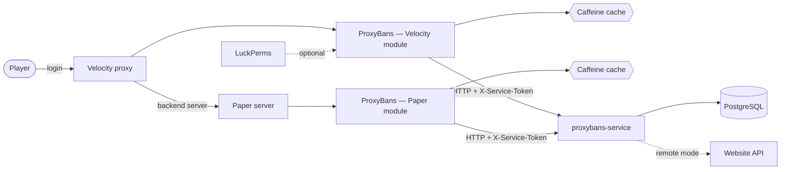

# ProxyBans — Velocity and Paper plugin

[](https://github.com/vanfek/proxybans-plugin/actions/workflows/ci.yml)
[](https://openjdk.org/projects/jdk/25/)

*[Русская версия](README.ru.md)*

Ban system for [Velocity](https://papermc.io/software/velocity) and
[Paper](https://papermc.io/software/paper). Ban state lives in a separate service
([proxybans-service](https://github.com/vanfek/proxybans-service)), so the same plugin works whether
punishments are stored in its own database or already owned by a website.

The interesting part is not the commands — it is what happens when the network misbehaves. A ban
check sits on the critical path of every player connection, so the plugin answers from a cache when
it can, falls back to a recent stale answer while the service is unreachable, and, when nothing
usable is cached, applies a configurable fail-open policy: the player is let in and the incident is
logged. Locking an entire network out because one internal service restarted is usually the worse
failure; `login.fail-open: false` inverts that trade-off.

---

## How it fits together



Four Gradle modules, dependencies pointing one way only:

| Module             | Contents                                                             |
|--------------------|----------------------------------------------------------------------|
| `modules/api`      | public SPI — `PunishmentService`, `ActivePunishmentView`, `Actor`    |
| `modules/core`     | HTTP client, cache, config, permissions, MiniMessage rendering        |
| `modules/velocity` | Velocity entry point, commands, login listener                        |
| `modules/paper`    | Paper entry point, commands, pre-login listener, chat mute listener   |

`api` and `core` carry no platform types at all, so a second platform is platform glue and nothing
else: `modules/paper` adds Brigadier command trees, two listeners and an `Actor`, and reuses
`PunishmentServiceImpl`, `PunishmentCache`, `ConfigLoader` and `MessageBundle` unchanged.

`core` talks to the service through the `PunishmentsClient` interface, so everything above the socket —
caching, the login decision, command handling — is tested without one.

## Which module to install

| | Velocity module | Paper module |
|---|---|---|
| Artifact | `ProxyBans-1.0.0.jar` | `ProxyBans-Paper-1.0.0.jar` |
| Blocks banned logins | yes, at the proxy | yes, on the backend server |
| Blocks muted chat | no — signed chat cannot be intercepted reliably | **yes** |
| Owns the commands | always | only on a standalone server |

Run a network behind a proxy: install both. The Velocity module issues and lifts punishments and
stops banned players at the edge; the Paper module exists for the one thing Velocity cannot do,
enforcing mutes, because signed chat from 1.19 on makes proxy-side chat interception unreliable.

Run a single Paper server with no proxy: install only the Paper module. It registers the full command
set and enforces both bans and mutes.

**Command ownership**: `commands.mode` decides whether the Paper module registers commands at all.
The default `auto` registers nothing when the server reports BungeeCord or Velocity forwarding as
enabled — the proxy owns the commands there — and registers everything on a standalone server;
`always` and `never` override the detection. The branch taken is logged on startup, so an admin never
has to guess where a command went.

Both modules read the same `config.yml` and `messages.yml`, and both talk to the same service, so a
mute issued on the proxy is enforced by the Paper module without any further wiring.

## Commands

Every command is available as `/pb <subcommand>` and, unless disabled, as a top-level alias. Names
already claimed by another plugin are skipped with a warning instead of being overwritten. Both
modules register the same tree with the same permission nodes; on Paper, whether they are registered
at all is decided by `commands.mode`.

| Command       | Aliases                                               | Permission                   |
|---------------|-------------------------------------------------------|------------------------------|
| `/ban`        | `permban`, `blacklist`, `banplayer`, `punish`         | `proxybans.command.ban`      |
| `/tempban`    | `tban`, `timedban`                                    | `proxybans.command.tempban`  |
| `/unban`      | `pardon`, `unblacklist`                               | `proxybans.command.unban`    |
| `/mute`       | `permmute`, `silence`, `muteplayer`                   | `proxybans.command.mute`     |
| `/tempmute`   | `tmute`, `timedmute`                                  | `proxybans.command.tempmute` |
| `/unmute`     | `unsilence`, `pardonmute`                             | `proxybans.command.unmute`   |
| `/warn`       | `caution`, `warnplayer`                               | `proxybans.command.warn`     |
| `/baninfo`    | `checkban`, `isbanned`, `banstatus`, `punishmentinfo` | `proxybans.command.info`     |
| `/banhistory` | `banlog`, `punishments`                               | `proxybans.command.history`  |
| `/banlist`    | `bans`, `activebans`, `punishmentlist`                | `proxybans.command.list`     |
| `/pb kick`    | —                                                     | `proxybans.command.kick`     |

`proxybans.admin` grants all of the above.

**Durations**: `30s`, `5m`, `2h30m`, `7d`, `1w`, `3M`, `1y`, or `perm` / `forever` / `0`.
Unit letters are case sensitive — `m` is minutes, `M` is months. Overflow, zero-length and
absurdly long durations are rejected rather than stored as a ban that expires in the past.

`/ban <player> [duration] <reason…>` takes the duration only when the first word actually looks like
one, so `/ban Steve cheating with hacks` bans Steve for cheating instead of complaining about an
invalid duration. `/mute` and `/tempmute` split their arguments the same way; `/warn <player>
<reason…>` is log-only, with no duration and nothing to lift.

Mutes are issued on the proxy and enforced by the Paper module — signed chat from 1.19 on makes
proxy-side chat interception unreliable. `/baninfo <player>` reports the active ban and the active
mute; `/baninfo <player> mute` and `/banlist [ban|mute] [page]` narrow either to one kind.

## Configuration

`plugins/proxybans/config.yml`:

```yaml
service:
  base-url: "http://proxybans:8080"
  token: ""              # must match PROXYBANS_SERVICE_TOKEN on the service
  connect-timeout: PT2S
  request-timeout: PT3S

cache:
  active-ttl: PT30S      # a fresh answer is served without asking again
  stale-ttl: PT30M       # how long a stale answer may cover an outage
  max-size: 100000

login:
  fail-open: true
  remember-player: true

chat:                    # Paper module only
  enforce-mute: true
  fail-open: true        # service down and nothing cached: let the message through
  blocked-commands: ["msg", "tell", "w", "whisper", "r", "reply", "me", "say", "pm"]

commands:
  register-top-level-aliases: true
  mode: auto             # Paper module only: auto | always | never
```

`chat.blocked-commands` covers the commands that are chat by another name; a muted player is stopped
on `/msg` as well as in chat. A namespace prefix such as `essentials:msg` is stripped before
matching, so aliasing does not get around the mute.

`plugins/proxybans/messages.yml` holds every string as a
[MiniMessage](https://docs.advntr.dev/minimessage/format.html) template. Placeholder values are
inserted verbatim and never parsed as markup, so a player cannot smuggle formatting, hover text or
click actions into staff messages through their name or a ban reason. Keys added in later versions
fall back to the bundled defaults instead of rendering as an error.

## Permissions

With LuckPerms installed, checks go through its player adapter. Without it, the platform's native
check applies, which grants players nothing and the console everything — a misconfigured server locks
staff out rather than handing `/ban` to everyone.

## Building

```bash
./gradlew build          # compiles, runs tests, produces the shaded jar
```

Artifacts: `modules/velocity/build/libs/ProxyBans-1.0.0.jar` and
`modules/paper/build/libs/ProxyBans-Paper-1.0.0.jar` → drop into `plugins/`.

Requires JDK 25. The Gradle wrapper is committed; nothing else needs installing.

The toolchain and the bytecode target are deliberately different: the build runs on a JDK 25
toolchain but compiles with `--release 21`, so the jars load on the Java 21 servers most people run.

## Tests

```bash
./gradlew test
```

Covered on purpose, because these are the places where a regression is expensive:

- duration parsing — months vs minutes, overflow, malformed input, the `/ban` argument split
- cache behaviour — fresh, stale, expired, negative caching (verified against a controllable clock)
- the login decision — banned, expired, fail-open, fail-closed, stale-cache enforcement
- command arguments — the mute duration split, `/warn` without a reason, `/banlist` kind and page
- the HTTP client — against a real socket: query escaping, non-JSON error pages, connection failures
- the Paper module — proxy auto-detection for all three `commands.mode` values, the chat mute
  decision (active, expired, service down under both fail-open settings), console identity mapping
