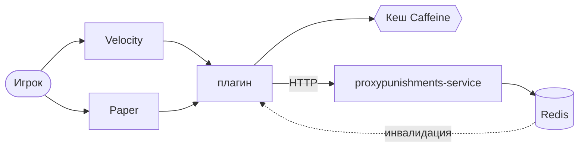

# ProxyPunishments — плагин для Velocity и Paper

[](https://github.com/vanFEK/proxypunishments-plugin-example/actions/workflows/ci.yml)
[](https://openjdk.org/projects/jdk/25/)

*[English version](README.md)*

Баны, муты, предупреждения и IP-баны для Minecraft-сетей. Состояние хранит отдельный сервис
([proxypunishments-service](https://github.com/vanFEK/proxypunishments-service-example)), поэтому
один и тот же плагин работает и с собственной БД, и когда наказаниями уже владеет сайт.

Проверка бана стоит на критическом пути каждого подключения, поэтому плагин отвечает из кеша, при
недоступном сервисе берёт недавний протухший ответ, а когда пригодного нет — применяет настраиваемую
политику fail-open: пустить одного забаненного лучше, чем закрыть вход всей сети.

## Архитектура



| Модуль             | Содержимое                                                          |
|--------------------|---------------------------------------------------------------------|
| `modules/api`      | публичный SPI: `PunishmentService`, `ActivePunishmentView`, `Actor` |
| `modules/core`     | HTTP-клиент, кеш, конфиг, пермишены, рендеринг MiniMessage           |
| `modules/velocity` | точка входа прокси, команды, проверка на входе                       |
| `modules/paper`    | точка входа сервера, команды, проверка на входе и в чате              |

Ни `api`, ни `core` не импортируют Velocity или Bukkit — именно поэтому Paper-модуль оказался
склейкой без новой логики.

**Что ставить.** Сеть за прокси: Velocity-модуль для команд и входа, Paper-модуль на каждый сервер
ради мутов в чате — прокси не может делать это надёжно с подписанным чатом начиная с 1.19.
Одиночный сервер: только Paper-модуль. Paper определяет форвардинг и отдаёт команды прокси;
`commands.mode` это переопределяет.

## Команды

Доступны как `/pp <подкоманда>` и, если не отключено, как команды верхнего уровня. Имена, занятые
другим плагином, пропускаются с предупреждением, а не перетираются.

| Команда       | Алиасы                                        | Пермишен            |
|---------------|-----------------------------------------------|---------------------|
| `/ban`        | `permban`, `blacklist`, `banplayer`, `punish` | `…command.ban`      |
| `/tempban`    | `tban`, `timedban`                            | `…command.tempban`  |
| `/unban`      | `pardon`, `unblacklist`                       | `…command.unban`    |
| `/mute`       | `permmute`, `silence`, `muteplayer`           | `…command.mute`     |
| `/tempmute`   | `tmute`, `timedmute`                          | `…command.tempmute` |
| `/unmute`     | `unsilence`, `pardonmute`                     | `…command.unmute`   |
| `/warn`       | `caution`, `warnplayer`                       | `…command.warn`     |
| `/ipban`      | `banip`, `ipblacklist`                        | `…command.ipban`    |
| `/unipban`    | `unbanip`, `pardonip`                         | `…command.unipban`  |
| `/alts`       | `accounts`, `altaccounts`                     | `…command.alts`     |
| `/baninfo`    | `checkban`, `isbanned`, `banstatus`           | `…command.info`     |
| `/banhistory` | `banlog`, `punishments`                       | `…command.history`  |
| `/banlist`    | `bans`, `activebans`                          | `…command.list`     |
| `/pp kick`    | —                                             | `…command.kick`     |
| `/pp status`  | `/pp stats`                                   | `…command.status`   |
| `/pp reload`  | —                                             | `…command.reload`   |

Ноды с префиксом `proxypunishments.`; `proxypunishments.admin` выдаёт все.

**Длительности**: `30s`, `5m`, `2h30m`, `7d`, `1w`, `3M`, `1y`, либо `perm`. Регистр значим:
`m` — минуты, `M` — месяцы. Переполнение, нулевая и абсурдная длительность отклоняются.

`/ban <ник> [длительность] <причина…>` берёт первое слово как длительность только если оно на неё
похоже, поэтому `/ban Steve cheating with hacks` банит Стива, а не ругается на длительность.

`/pp reload` меняет `config.yml` и `messages.yml` вместе или никак и прямо называет настройки,
привязанные при старте — URL сервиса, таймауты, размер кеша, Redis, — вместо того чтобы делать вид,
что они применились.

## Конфигурация

`plugins/proxypunishments/config.yml`:

```yaml
service:
  base-url: "http://proxypunishments:8080"
  token: ""              # должен совпадать с PROXYPUNISHMENTS_SERVICE_TOKEN на сервисе
  connect-timeout: PT2S
  request-timeout: PT3S

cache:
  active-ttl: PT30S      # свежий ответ отдаётся без обращения к сервису
  stale-ttl: PT30M       # сколько протухший ответ может прикрывать аварию
  max-size: 100000

redis:                   # опционально, по умолчанию выключен
  enabled: false
  host: "redis"
  port: 6379
  channel: "proxypunishments.invalidations"   # должен совпадать с сервисом

login:
  fail-open: true
  remember-player: true

chat:                    # только Paper-модуль
  enforce-mute: true
  fail-open: true
  blocked-commands: ["msg", "tell", "w", "r", "me", "say"]

commands:
  register-top-level-aliases: true
  mode: auto             # только Paper-модуль: auto | always | never
```

С включённым Redis наказание, выданное на одной ноде, сбрасывает кеш на всех остальных сразу, а не
через `active-ttl`. Выключен или недоступен — плагин логирует один раз, переподключается в фоне и
живёт на TTL.

`messages.yml` — все строки как шаблоны
[MiniMessage](https://docs.advntr.dev/minimessage/format.html). Значения плейсхолдеров вставляются
без разбора разметки, поэтому причина бана не протащит форматирование в сообщение персоналу. Ключи,
добавленные в новых версиях, берутся из встроенных дефолтов.

## Пермишены

С LuckPerms проверки идут через его закешированные данные и никогда не блокируют. Без него работает
нативная проверка платформы: игрокам ничего, консоли всё — неверно настроенный сервер закроет доступ
персоналу, а не раздаст `/ban` всем.

## Персональные данные

При `login.remember-player` плагин отправляет сервису UUID, ник и адрес подключения — адрес нужен
для IP-банов и поиска альтов. Срок хранения — на усмотрение оператора: сервис хранит то, что ему
передали, и сам ничего не удаляет.

## Сборка

```bash
./gradlew build
```

Артефакты: `modules/velocity/build/libs/ProxyPunishments-1.0.0.jar` и
`modules/paper/build/libs/ProxyPunishments-Paper-1.0.0.jar`.

Собирается на тулчейне JDK 25, но в байткод Java 21 — чтобы jar'ы грузились на серверах, которые
реально используют. `build` также прогоняет Checkstyle (`config/checkstyle/checkstyle.xml`); тег
`v*` запускает релиз. См. [CHANGELOG.md](CHANGELOG.md).

## Тесты

165 тестов, там, где регрессия дороже всего:

- парсинг длительностей — месяцы против минут, переполнение, мусор, разбор аргументов `/ban`
- кеш — свежий, протухший, истёкший, отрицательный ответ, изоляция по типу, на управляемых часах
- решение о входе — забанен, бан истёк, IP-бан, fail-open, fail-closed, протухший кеш
- применение мута в чате, определение прокси, перезагрузка конфига
- HTTP-клиент — против настоящего сокета: экранирование, не-JSON ошибки, обрыв связи
