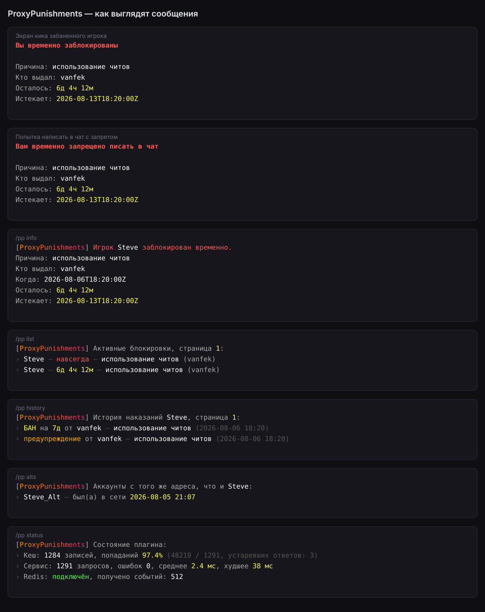
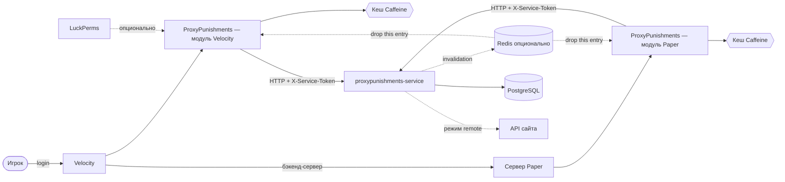

# ProxyPunishments — плагин для Velocity и Paper

[](https://github.com/vanfek/proxypunishments-plugin/actions/workflows/ci.yml)
[](https://openjdk.org/projects/jdk/25/)

*[English version](README.md)*

Система банов для [Velocity](https://papermc.io/software/velocity) и
[Paper](https://papermc.io/software/paper). Состояние банов хранит отдельный сервис
([proxypunishments-service](https://github.com/vanfek/proxypunishments-service)), поэтому один и тот же плагин
работает и когда наказания лежат в собственной БД, и когда ими уже владеет сайт.

Интересное здесь не команды, а поведение при сбоях. Проверка бана стоит на критическом пути каждого
подключения, поэтому плагин отвечает из кеша, пока может; если сервис недоступен — использует
недавний протухший ответ; а когда пригодного нет вообще, применяет настраиваемую политику fail-open:
игрока пускают, инцидент пишется в лог. Заблокировать вход всей сети из-за перезапуска одного
внутреннего сервиса обычно хуже. `login.fail-open: false` переворачивает этот компромисс.



Это отрисовка шаблонов сообщений, а не игровой скриншот:
[`docs/preview/render_messages.py`](docs/preview/render_messages.py) собирает картинку прямо из
`messages.yml`, поэтому она не может разойтись с тем, что настраивает оператор.

---

## Как устроено



Четыре Gradle-модуля, зависимости только в одну сторону:

| Модуль             | Содержимое                                                             |
|--------------------|------------------------------------------------------------------------|
| `modules/api`      | публичный SPI: `PunishmentService`, `ActivePunishmentView`, `Actor`    |
| `modules/core`     | HTTP-клиент, кеш, конфиг, пермишены, рендеринг MiniMessage              |
| `modules/velocity` | точка входа Velocity, команды, login-listener                           |
| `modules/paper`    | точка входа Paper, команды, pre-login-listener, listener мута в чате    |

В `api` и `core` нет ни одного типа платформы, поэтому вторая платформа — это только связующий код:
`modules/paper` добавляет деревья команд Brigadier, два листенера и `Actor`, а `PunishmentServiceImpl`,
`PunishmentCache`, `ConfigLoader` и `MessageBundle` использует как есть.

`core` общается с сервисом через интерфейс `PunishmentsClient`, поэтому всё, что выше сокета — кеш,
решение о входе, обработка команд — тестируется без сети.

## Какой модуль ставить

| | Модуль Velocity | Модуль Paper |
|---|---|---|
| Артефакт | `ProxyPunishments-1.0.0.jar` | `ProxyPunishments-Paper-1.0.0.jar` |
| Не пускает забаненных | да, на прокси | да, на бэкенд-сервере |
| Блокирует чат при муте | нет — подписанный чат не перехватить надёжно | **да** |
| Владеет командами | всегда | только на одиночном сервере |

Сеть за прокси: ставьте оба. Модуль Velocity выдаёт и снимает наказания и не пускает забаненных на
входе; модуль Paper существует ради того единственного, чего Velocity не умеет, — применения мутов,
потому что подписанный чат начиная с 1.19 делает перехват на прокси ненадёжным.

Одиночный сервер Paper без прокси: ставьте только модуль Paper. Он регистрирует полный набор команд
и применяет и баны, и муты.

**Кто владеет командами**: `commands.mode` решает, регистрирует ли модуль Paper команды вообще.
Значение по умолчанию `auto` не регистрирует ничего, если сервер сообщает о включённом форвардинге
BungeeCord или Velocity — там командами владеет прокси, — и регистрирует всё на одиночном сервере;
`always` и `never` перекрывают автоопределение. Выбранная ветка пишется в лог при старте, чтобы
администратору не пришлось гадать, куда делась команда.

Оба модуля читают один и тот же `config.yml` и `messages.yml` и ходят в один и тот же сервис,
поэтому мут, выданный на прокси, применяется модулем Paper без дополнительной настройки.

## Команды

Всё доступно как `/pp <подкоманда>` и, если не отключено, как команды верхнего уровня. Имена, уже
занятые другим плагином, пропускаются с предупреждением, а не перетираются. Оба модуля регистрируют
одно и то же дерево с одними и теми же пермишенами; на Paper то, регистрируются ли они вообще,
решает `commands.mode`.

| Команда       | Алиасы                                                | Пермишен                     |
|---------------|-------------------------------------------------------|------------------------------|
| `/ban`        | `permban`, `blacklist`, `banplayer`, `punish`         | `proxypunishments.command.ban`      |
| `/tempban`    | `tban`, `timedban`                                    | `proxypunishments.command.tempban`  |
| `/unban`      | `pardon`, `unblacklist`                               | `proxypunishments.command.unban`    |
| `/mute`       | `permmute`, `silence`, `muteplayer`                   | `proxypunishments.command.mute`     |
| `/tempmute`   | `tmute`, `timedmute`                                  | `proxypunishments.command.tempmute` |
| `/unmute`     | `unsilence`, `pardonmute`                             | `proxypunishments.command.unmute`   |
| `/warn`       | `caution`, `warnplayer`                               | `proxypunishments.command.warn`     |
| `/baninfo`    | `checkban`, `isbanned`, `banstatus`, `punishmentinfo` | `proxypunishments.command.info`     |
| `/banhistory` | `banlog`, `punishments`                               | `proxypunishments.command.history`  |
| `/banlist`    | `bans`, `activebans`, `punishmentlist`                | `proxypunishments.command.list`     |
| `/ipban`      | `banip`, `ipblacklist`                                | `proxypunishments.command.ipban`    |
| `/unipban`    | `unbanip`, `pardonip`                                 | `proxypunishments.command.unipban`  |
| `/alts`       | `accounts`, `altaccounts`                             | `proxypunishments.command.alts`     |
| `/pp kick`    | —                                                     | `proxypunishments.command.kick`     |
| `/pp status`  | `/pp stats`                                           | `proxypunishments.command.status`   |
| `/pp reload`  | —                                                     | `proxypunishments.command.reload`   |

`proxypunishments.admin` выдаёт все перечисленные.

`/pp reload` перечитывает `config.yml` и `messages.yml` и подменяет оба разом — либо ни одного, если
хоть один не разобрался: тогда об ошибке сообщается, а плагин продолжает работать на том, что уже
было загружено. Всё, что связывается при старте, перечисляется в ответе с текущим и с новым
значением, чтобы не приходилось гадать, нужен ли перезапуск: адрес сервиса, токен и таймауты, размер
кеша, соединение с Redis и регистрация команд без него не меняются. `login.*` и `chat.*` вступают в
силу сразу же.

**Длительности**: `30s`, `5m`, `2h30m`, `7d`, `1w`, `3M`, `1y`, либо `perm` / `forever` / `0`.
Регистр буквы значим: `m` — минуты, `M` — месяцы. Переполнение, нулевая и абсурдно большая
длительность отклоняются, а не превращаются в бан, истёкший в прошлом.

`/ban <ник> [длительность] <причина…>` берёт первое слово как длительность только если оно
действительно на неё похоже, поэтому `/ban Steve cheating with hacks` банит Стива за читы, а не
ругается на неверную длительность. `/mute` и `/tempmute` разбирают аргументы так же; `/warn <ник>
<причина…>` только пишется в журнал: ни длительности, ни снятия.

Муты выдаются на прокси, а применяет их Paper-модуль: подписанный чат начиная с 1.19 делает
перехват на прокси ненадёжным. `/baninfo <ник>` показывает и активный бан, и активный мут,
`/baninfo <ник> mute` и `/banlist [ban|mute] [страница]` сужают вывод до одного типа.

`/ipban <ник|адрес> [длительность] <причина…>` и `/unipban <ник|адрес> [причина]` принимают либо
литерал IPv4/IPv6, либо ник игрока, который сейчас в сети — тогда берётся адрес его подключения.
Всё остальное сообщается, а не угадывается. IP-бан проверяется на входе после личного бана игрока
и отклоняет подключение своим отдельным сообщением, поэтому забаненный адрес не пускает и те
аккаунты, которых самих никто не наказывал. `/alts <ник>` показывает другие аккаунты, которых
последний раз видели с того же адреса, свежие сверху.

## Межпроксевая инвалидация кеша

Наказание, выданное на одном прокси, невидимо кешу другого прокси, пока не истечёт `cache.active-ttl`
— по умолчанию 30 секунд. Направьте оба на тот же Redis, что и сервис, и это окно закрывается: сервис
публикует одно сообщение на выдачу и на снятие, каждый экземпляр плагина выбрасывает ровно одну
запись и на следующем запросе снова спрашивает сервис.

```yaml
redis:
  enabled: true
  host: "redis"
  channel: "proxypunishments.invalidations"   # должен совпадать с сервисом
```

**Необязательно и выключено по умолчанию.** При `enabled: false` код Redis не выполняется вовсе и
плагин ведёт себя ровно так же, как раньше. Redis включён, но недоступен — подписка падает,
логируется один раз и переподключается каждые `reconnect-delay` в фоне; наказания продолжают
работать по кешу и TTL, и ни в логин, ни в команду ничего не прилетает.

Подписчик живёт на своём daemon-потоке `proxypunishments-redis-subscriber`. `SUBSCRIBE` в Redis
занимает соединение на всё время подписки, поэтому он не должен сидеть на потоке Netty или главного
сервера — и не сидит.

**Какой клиент и почему**: [Jedis](https://github.com/redis/jedis) через низкоуровневый `Connection`
и `JedisPubSub`, не Lettuce. Lettuce тянет за собой весь Netty, который у прокси уже есть — другой
версии, — а шейдить второй Netty в jar плагина значит напрашиваться на спор загрузчиков классов.
Jedis — это обычный сокет и блокирующее чтение, ровно та форма, которая нужна потоку, сидящему на
SUBSCRIBE. `Connection` вместо фасада `Jedis` оставляет за бортом всю поверхность команд и потому
резко уменьшает шейженный jar; gson, slf4j и `org.json` исключены, потому что обе платформы их и так
поставляют. Jedis и commons-pool2 переезжают под `net.vanfek.proxypunishments.libs`, чтобы чужой
плагин со своим Jedis не столкнулся с этим. Цена честная: около **485 КиБ**, каждый шейженный jar
растёт с ~1,78 МиБ до ~2,26 МиБ.

## Состояние и метрики

Скрейпить на прокси нечего, поэтому цифры выходят через `/pp status`:

- сколько записей в кеше, доля попаданий, попадания, промахи и сколько ответов отдано протухшими
- запросы к сервису, ошибки, среднее и худшее время ответа
- Redis выключен, подключён или без связи, и сколько событий применено

Та же сводка пишется в лог при выключении плагина, так что после рестарта остаётся след того, как
вёл себя кеш, даже если команду никто не вводил.

## Конфигурация

`plugins/proxypunishments/config.yml`:

```yaml
service:
  base-url: "http://proxypunishments:8080"
  token: ""              # должен совпадать с PROXYPUNISHMENTS_SERVICE_TOKEN на сервисе
  connect-timeout: PT2S
  request-timeout: PT3S

cache:
  active-ttl: PT30S      # свежий ответ отдаётся без обращения к сервису
  stale-ttl: PT30M       # сколько протухший ответ может прикрывать аварию
  max-size: 100000

redis:                   # необязательно, по умолчанию выключено
  enabled: false
  host: "redis"
  port: 6379
  username: ""
  password: ""
  database: 0
  channel: "proxypunishments.invalidations"   # должен совпадать с сервисом
  connect-timeout: PT2S
  reconnect-delay: PT5S

login:
  fail-open: true
  remember-player: true

chat:                    # только модуль Paper
  enforce-mute: true
  fail-open: true        # сервис недоступен и в кеше пусто: пропустить сообщение
  blocked-commands: ["msg", "tell", "w", "whisper", "r", "reply", "me", "say", "pm"]

commands:
  register-top-level-aliases: true
  mode: auto             # только модуль Paper: auto | always | never
```

`chat.blocked-commands` перечисляет команды, которые по сути тот же чат: замученного игрока
останавливают и на `/msg`, и в чате. Префикс неймспейса вроде `essentials:msg` отбрасывается перед
сравнением, поэтому обойти мут через алиас не выйдет.

`plugins/proxypunishments/messages.yml` — все строки как шаблоны
[MiniMessage](https://docs.advntr.dev/minimessage/format.html). Значения плейсхолдеров
подставляются буквально и никогда не парсятся как разметка: игрок не сможет протащить форматирование,
hover или клик в сообщения для персонала через свой ник или причину бана. Ключи, добавленные в новых
версиях, берутся из встроенных дефолтов, а не рендерятся ошибкой.

## Пермишены

С установленным LuckPerms проверки идут через его player adapter. Без него работает нативная
проверка платформы: игрокам не даётся ничего, консоли — всё. Неверно настроенный сервер закроет
доступ персоналу, а не раздаст `/ban` всем подряд.

## Персональные данные

При включённом `login.remember-player` плагин вместе с ником отправляет адрес, с которого игрок
подключился, а сервис сохраняет его как последний известный адрес этого игрока. Именно это делает
IP-баны применимыми на входе, а `/alts` — способным вообще что-то ответить. IP-адрес в большинстве
юрисдикций — персональные данные; сколько его хранить, кому давать читать и когда стирать, решает
оператор: сам плагин его не удаляет. Выключите `login.remember-player`, и адрес не покинет прокси.

## Сборка

```bash
./gradlew build          # компиляция, Checkstyle, тесты, shaded-jar
```

Артефакты: `modules/velocity/build/libs/ProxyPunishments-1.0.0.jar` и
`modules/paper/build/libs/ProxyPunishments-Paper-1.0.0.jar` → в папку `plugins/`.

Нужен JDK 25. Gradle wrapper закоммичен, ставить больше нечего.

Тулчейн и целевой байт-код намеренно разные: сборка идёт на тулчейне JDK 25, но компилируется с
`--release 21`, поэтому jar-ы загружаются на серверах с Java 21, которых у большинства и стоит.

Checkstyle входит в `build` и роняет сборку на отклонении от стиля. Правила лежат в
[`config/checkstyle/checkstyle.xml`](config/checkstyle/checkstyle.xml) и описывают те соглашения,
которым исходники уже следуют: проверка стиля, требующая переформатирования, — проверка, которую
никто не запускает.

Заметные изменения записываются в [`CHANGELOG.md`](CHANGELOG.md). Тег `v*` запускает workflow
релиза: он собирает оба модуля и прикладывает два jar-а к релизу на GitHub.

## Тесты

```bash
./gradlew test
```

Покрыто намеренно там, где регрессия дороже всего:

- парсинг длительностей — месяцы против минут, переполнение, мусор на входе, разбор аргументов `/ban`
- парсинг адресов — литералы принимаются, имена хостов, мусор и попытки инъекции отклоняются
- поведение кеша — свежий, протухший, истёкший, кеширование отрицательного ответа и записи по адресу,
  которые никогда не отвечают на запрос по игроку и наоборот (на управляемых часах)
- решение о логине — забанен, бан истёк, fail-open, fail-closed, применение протухшего кеша и IP-бан,
  отклоняющий игрока, у которого своего бана нет
- аргументы команд — разбор длительности мута, `/warn` без причины, тип и страница в `/banlist`,
  `/ipban` по адресу и по игроку в сети, `/alts`, покрытие новых узлов через `proxypunishments.admin`
- HTTP-клиент — против настоящего сокета: экранирование запроса, не-JSON страницы ошибок, обрыв связи,
  эндпоинты по адресу и адрес в вызове known-players
- инвалидация кеша — событие сбрасывает нужную запись и только её, адреса и игроки не пересекаются,
  события про других игроков игнорируются, битые сообщения отбрасываются, выключенный Redis ничего
  не запускает, недоступный Redis не доходит до запроса наказания
- метрики за `/pp status` — доля попаданий на повторных запросах, протухшие ответы считаются отдельно
  от попаданий
- `/pp reload` — подмена вступает в силу на следующем же сообщении, битый файл оставляет прежнюю
  конфигурацию нетронутой, а в ответе перечислены настройки, которые меняет только перезапуск
- модуль Paper — автоопределение прокси для всех трёх значений `commands.mode`, решение о муте в чате
  (активен, истёк, сервис недоступен при обоих значениях fail-open), маппинг личности консоли
