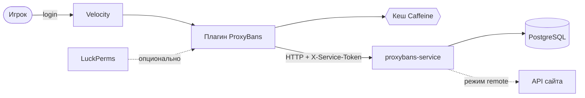
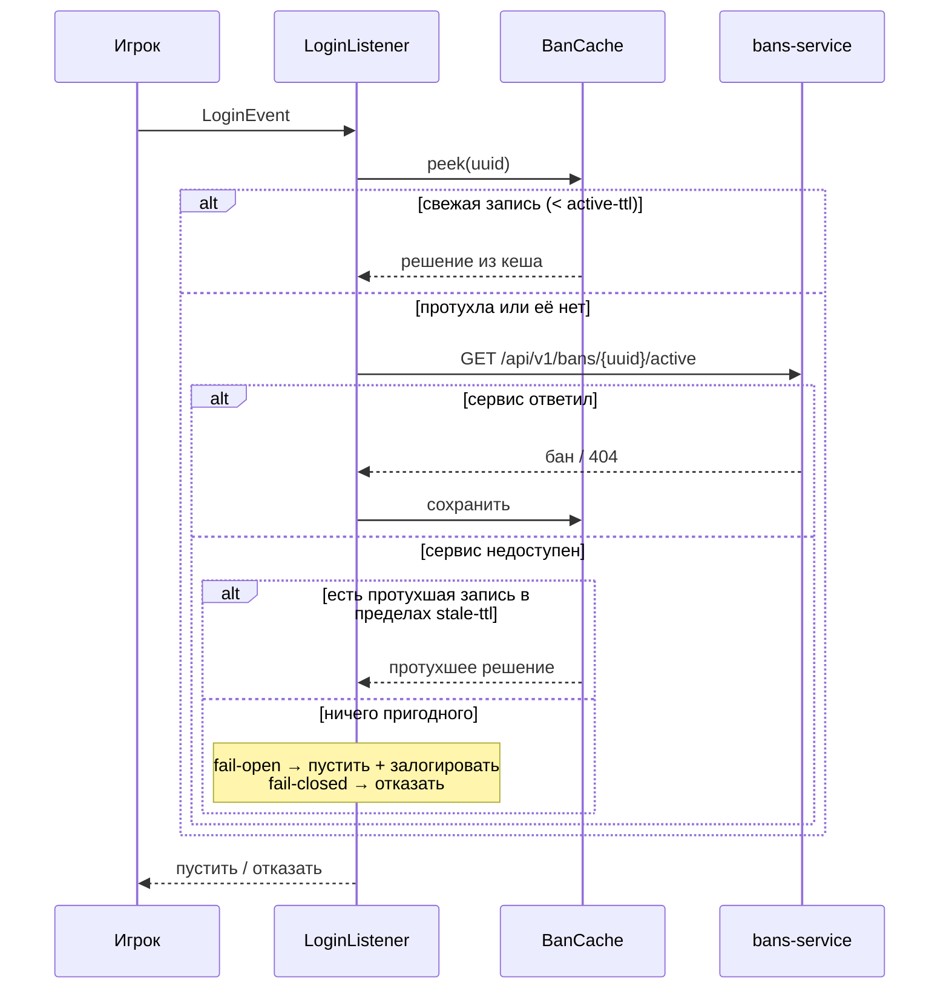

# ProxyBans — плагин для Velocity

[](https://github.com/vanfek/proxybans-plugin/actions/workflows/ci.yml)
[](https://openjdk.org/projects/jdk/25/)
[](LICENSE)

*[English version](README.md)*

Система банов на стороне прокси [Velocity](https://papermc.io/software/velocity). Состояние банов
хранит отдельный сервис ([proxybans-service](https://github.com/vanfek/proxybans-service)), поэтому
один и тот же плагин работает и когда наказания лежат в собственной БД, и когда ими уже владеет сайт.

Интересное здесь не команды, а поведение при сбоях. Проверка бана стоит на критическом пути каждого
подключения, поэтому плагин построен вокруг вопроса: *что делать, когда ответа вовремя нет?*

---

## Как устроено



Три Gradle-модуля, зависимости только в одну сторону:

| Модуль             | Содержимое                                                        |
|--------------------|-------------------------------------------------------------------|
| `modules/api`      | публичный SPI: `BanService`, `ActiveBanView`, `PunishmentHistoryEntry` |
| `modules/core`     | HTTP-клиент, кеш, конфиг, пермишены, рендеринг MiniMessage         |
| `modules/velocity` | точка входа Velocity, команды, login-listener                      |

`core` общается с сервисом через интерфейс `BansClient`, поэтому всё, что выше сокета — кеш,
решение о входе, обработка команд — тестируется без сети.

## Путь логина



Обе политики выбраны осознанно:

- **Протухший кеш.** Сервис лёг, но недавний ответ есть — используем его. Протухшее «забанен»
  намного лучше, чем пустить забаненного из-за перезапуска бэкенда.
- **Fail-open** (по умолчанию, настраивается). Если и в кеше ничего пригодного — игрока пускают,
  инцидент пишется в лог. Заблокировать вход всей сети из-за одного внутреннего сервиса обычно
  хуже. `login.fail-open: false` переворачивает этот компромисс.

Если конфиг не читается вовсе, плагин откатывается на встроенные значения, а не остаётся
полуинициализированным: плагин, который залогировал ошибку и не зарегистрировал слушатель, выглядит
живым и при этом тихо пропускает всех забаненных.

## Команды

Всё доступно как `/pb <подкоманда>` и, если не отключено, как команды верхнего уровня. Имена, уже
занятые другим плагином, пропускаются с предупреждением, а не перетираются.

| Команда       | Алиасы                                        | Пермишен                    |
|---------------|-----------------------------------------------|-----------------------------|
| `/ban`        | `permban`, `blacklist`, `banplayer`, `punish` | `proxybans.command.ban`     |
| `/tempban`    | `tban`, `timedban`                            | `proxybans.command.tempban` |
| `/unban`      | `pardon`, `unblacklist`                       | `proxybans.command.unban`   |
| `/baninfo`    | `checkban`, `isbanned`, `banstatus`           | `proxybans.command.info`    |
| `/banhistory` | `banlog`, `punishments`                       | `proxybans.command.history` |
| `/banlist`    | `bans`, `activebans`                          | `proxybans.command.list`    |
| `/pb kick`    | —                                             | `proxybans.command.kick`    |

`proxybans.admin` выдаёт все перечисленные.

**Длительности**: `30s`, `5m`, `2h30m`, `7d`, `1w`, `3M`, `1y`, либо `perm` / `forever` / `0`.
Регистр буквы значим: `m` — минуты, `M` — месяцы. Переполнение, нулевая и абсурдно большая
длительность отклоняются, а не превращаются в бан, истёкший в прошлом.

`/ban <ник> [длительность] <причина…>` берёт первое слово как длительность только если оно
действительно на неё похоже, поэтому `/ban Steve cheating with hacks` банит Стива за читы, а не
ругается на неверную длительность.

## Конфигурация

`plugins/proxybans/config.yml`:

```yaml
service:
  base-url: "http://proxybans:8080"
  token: ""              # должен совпадать с PROXYBANS_SERVICE_TOKEN на сервисе
  connect-timeout: PT2S
  request-timeout: PT3S

cache:
  active-ttl: PT30S      # свежий ответ отдаётся без обращения к сервису
  stale-ttl: PT30M       # сколько протухший ответ может прикрывать аварию
  max-size: 100000

login:
  fail-open: true
  remember-player: true

commands:
  register-top-level-aliases: true
```

`plugins/proxybans/messages.yml` — все строки как шаблоны
[MiniMessage](https://docs.advntr.dev/minimessage/format.html). Значения плейсхолдеров
подставляются буквально и никогда не парсятся как разметка: игрок не сможет протащить форматирование,
hover или клик в сообщения для персонала через свой ник или причину бана. Ключи, добавленные в новых
версиях, берутся из встроенных дефолтов, а не рендерятся ошибкой.

## Пермишены

С установленным LuckPerms проверки идут через его player adapter. Без него работает нативная
проверка Velocity: игрокам не даётся ничего, консоли — всё. Неверно настроенный сервер закроет
доступ персоналу, а не раздаст `/ban` всем подряд.

## Сборка

```bash
./gradlew build          # компиляция, тесты, shaded-jar
```

Артефакт: `modules/velocity/build/libs/ProxyBans-1.0.0.jar` → в папку `plugins/`.

Нужен JDK 25. Gradle wrapper закоммичен, ставить больше нечего.

## Тесты

```bash
./gradlew test
```

Покрыто намеренно там, где регрессия дороже всего:

- парсинг длительностей — месяцы против минут, переполнение, мусор на входе, разбор аргументов `/ban`
- поведение кеша — свежий, протухший, истёкший, кеширование отрицательного ответа (на управляемых часах)
- решение о логине — забанен, бан истёк, fail-open, fail-closed, применение протухшего кеша
- HTTP-клиент — против настоящего сокета: экранирование запроса, не-JSON страницы ошибок, обрыв связи

## Лицензия

MIT — см. [LICENSE](LICENSE).
